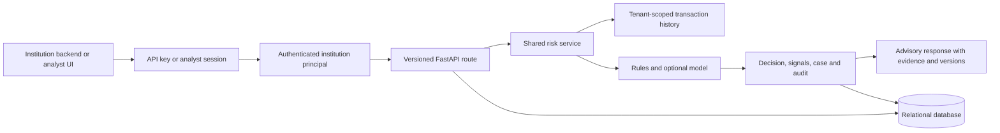

# Architecture

Cerviqon is a modular monolith: FastAPI routes call feature/risk/case services backed by SQLAlchemy and one relational database. PostgreSQL is configured for deployment; SQLite is the zero-configuration local/demo default. Model inference runs inside the API process using a pre-trained Isolation Forest artifact. Offline scripts generate the artifact; request handlers never train it.

Every score stores a transaction, triggered signals, versioned risk decision, applicable intervention, and audit event. HOLD and REVIEW recommendations create open analyst cases. Analyst outcomes update the case and append an audit event. Metrics are derived from stored decisions and outcomes.

The sandbox uses synthetic entities and stable demo transaction IDs. It does not execute payments, inspect private communications, or establish whether a customer was manipulated.

## Request and tenant data flow

The authenticated principal supplies the institution scope; callers cannot choose a tenant in the request body. The tenant_identifiers table maps institution-scoped external references to deterministic internal IDs. Existing database rows are assigned to the reserved default tenant by migration. API keys must be unique per institution. Analyst sessions carry the institution assignment configured for that account. Public health and login routes do not access tenant data.

Supported API reads and writes apply the same scope to transactions, related assessments/signals, cases/outcomes, interventions, audit events, metrics, and transaction history used for feature extraction. Model inference and scoring are shared across dashboard and API flows. Investigation feedback is stored for audit and evaluation; there is no automatic training path.
